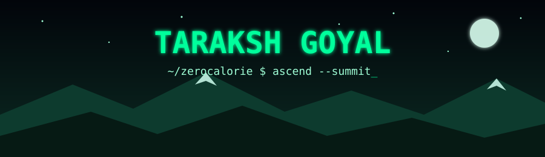
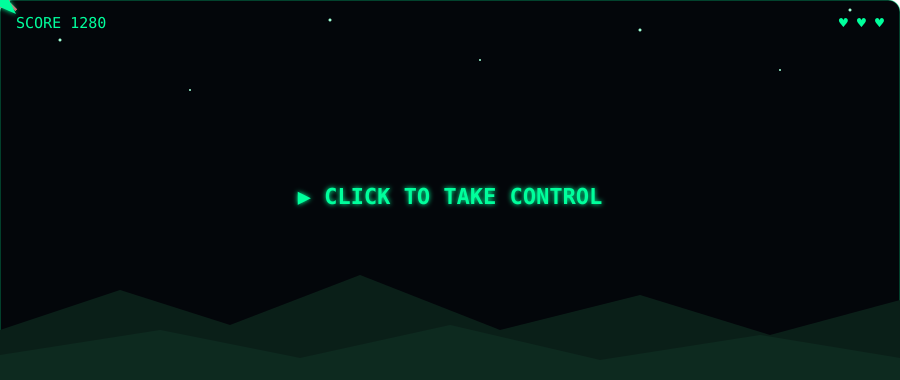
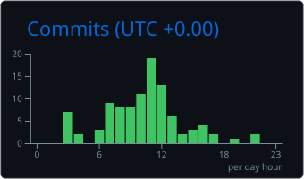
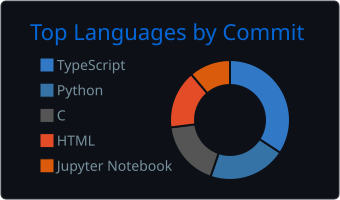

---

## 🎮 Play before you scroll

*Live gameplay loop · click the screen to take over the controls*

## 🐍 The snake is eating my commits

## 🧗 Current climbs

<b>🌪️ CYCLONE</b>: 45M-parameter recurrent-depth language model, trained from scratch

 

Custom architecture, full training pipeline, and a lot of debugging: masking bugs, representation collapse, and validation plumbing. Next up: a retrain with more diverse data and a latent reasoning mode.

<b>📦 Amazon ML Challenge 2025</b>: Smart Product Pricing

 

Multimodal price prediction from catalog text and product images, built to run on a 4GB GPU.

<b>🧠 COGNITION</b>: AI-assisted development bootcamp with the Microsoft Technical Committee

 

Helping organise an eight-week online curriculum covering full-stack, mobile, ML/DL and LLM tooling.

## 🧰 Gear

## 📊 Altitude log

 

 

 

<b>🧩 LeetCode trail</b>

 

<b>🔐 classified</b> (don't open)

 

[Declassify the file](https://www.youtube.com/watch?v=dQw4w9WgXcQ) 😉

